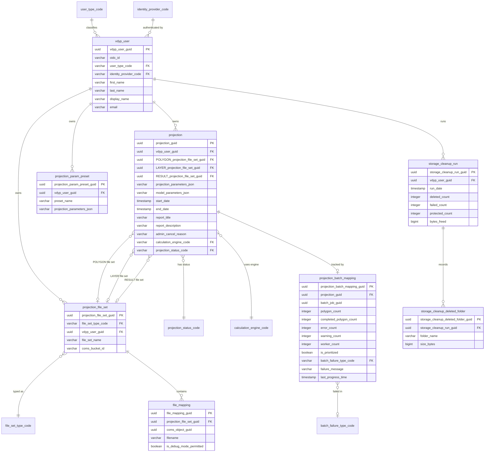
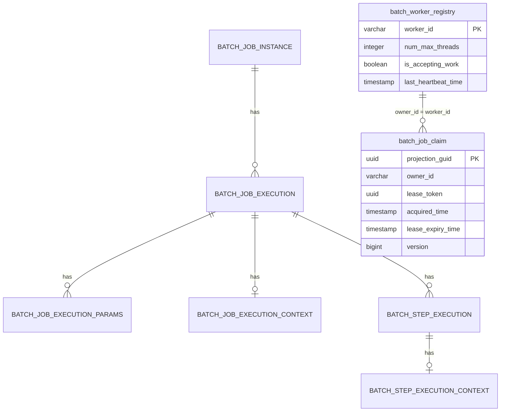
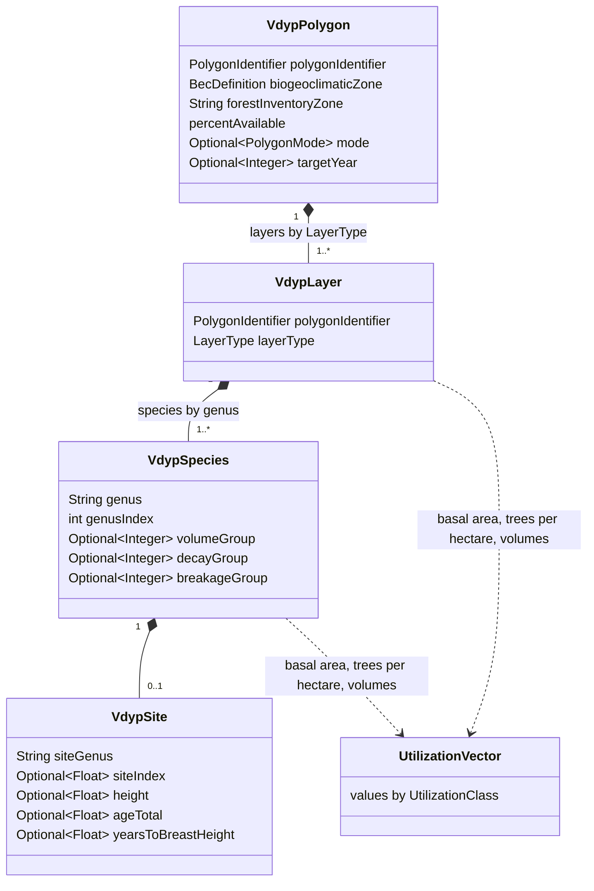

# VDYP Data Model

This document describes the persistent data model (PostgreSQL) and the main in-memory computation model. The persistent model was derived from the Liquibase scripts in `db/liquibase/scripts` and the JPA entities in `backend/src/main/java/ca/bc/gov/nrs/vdyp/backend/data/entities`. The logical model is also maintained in Enterprise Architect (`db/eap/VDYP-LogicalModel.EAP`); if the two disagree, the Liquibase scripts are authoritative for what is deployed.

## 1. Databases and schemas

| Database (local name) | Schema | Owner | Changelog | Purpose |
| --- | --- | --- | --- | --- |
| `VDYP_DB_DATABASE` | `app-vdyp` | Backend | `db/liquibase/vdyp-changelog.json` | Users, projections, file sets, files, code tables, cleanup audit. |
| `BATCH_DB_DATABASE` | `batch` | Batch service | `db/liquibase/batch-changelog.json` | Spring Batch job repository, job claims, worker registry. |
| (admin) | n/a | DBA | `db/liquibase/postgres-changelog.json` | Roles, grants and search paths. |

The backend connects as `proxy-vdyp-rest`, which is granted the role `app_vdyp_rest_proxy`. COMS uses its own database on the same PostgreSQL cluster; its schema is managed by COMS and is not described here.

## 2. Application schema (`app-vdyp`)

Audit columns are omitted from the diagram for readability. See section 4.

### 2.1 Tables

| Table | Description (from table comments) |
| --- | --- |
| `vdyp_user` | Profiles for users that access VDYP; controls access to projection files, parameters and results. Created or updated on each authenticated request by `OidcUserSyncFilter`. |
| `projection` | All the inputs used to create a projection: a polygon file set, a layer file set, and JSON encoded parameters. Also references the result file set. |
| `projection_file_set` | A typed grouping of files used in a projection (polygon, layer or result). |
| `file_mapping` | Maps an object in COMS to a file set in VDYP. |
| `projection_batch_mapping` | Maps a projection to the external batch job, with details that only the batch system updates (counts, failure, progress time, prioritization). |
| `projection_param_preset` | A named, saved copy of projection parameters. |
| `storage_cleanup_run` | One administrator-triggered PVC storage cleanup run: who ran it, when, and the outcome counts. |
| `storage_cleanup_deleted_folder` | One PVC job folder deleted by a storage cleanup run. |

### 2.2 Code tables

All code tables share the columns `description`, `display_order`, `effective_date` and `expiry_date`, plus the audit columns. Values below come from the `dml` scripts.

| Code table | Values |
| --- | --- |
| `projection_status_code` | `DRAFT` Draft, `QUEUED` Queued, `RUNNING` Running, `READY` Ready, `FAILED` Failed, `STUCK` Stuck, `ADMN_CNCLD` Admin Cancelled |
| `file_set_type_code` | `POLYGON` Polygon Files, `LAYER` Layer Files, `RESULTS` Result Files |
| `user_type_code` | `ADMIN` Administrator, `SUPERUSER` Power User, `USER` User, `SYSTEM` System |
| `identity_provider_code` | `IDIR` IDIR, `BCEID` BCeID, `BCSC` BC Services Card |
| `calculation_engine_code` | `VDYP8` VDYP8 |
| `batch_failure_type_code` | `INPUT` Processing Inputs, `PROCESS` Projecting Stands, `OUTPUT` Aggregating Results |

Note: `COMPLETE` and `INPROGRESS` were renamed to `READY` and `RUNNING` in version `01_00_03`. The table comment on `projection_status_code` still lists the older values.

### 2.3 JSON columns

`projection.projection_parameters_json`, `projection.model_parameters_json` and `projection_param_preset.projection_parameters_json` store serialized request models from `vdyp-extended-core` (`ca.bc.gov.nrs.vdyp.ecore.model.v1.Parameters`) and the backend `ModelParameters`. Changes to those Java classes must remain backward compatible with stored JSON, or a data migration must be provided.

## 3. Batch schema (`batch`)

| Table | Description |
| --- | --- |
| `BATCH_*` | Standard Spring Batch job repository tables (version `01_00_09`). Not auto-created by the application. |
| `batch_job_claim` | Atomically tracks which batch replica has the right to process a job. The lease must be renewed by heartbeat before `lease_expiry_time`. `version` supports optimistic updates. |
| `batch_worker_registry` | Registered batch replicas, their thread capacity, whether they accept work, and their last heartbeat. Entries without a heartbeat for over a day are removed by a daily scheduled job in the batch service. |

The relationship between `batch_job_claim.owner_id` and `batch_worker_registry.worker_id` is logical; no foreign key is defined. `batch_job_claim.projection_guid` refers to `app-vdyp.projection.projection_guid` in a different database, so it is also not enforced.

## 4. Common column conventions

| Column | Meaning |
| --- | --- |
| `<table>_guid` | UUID primary key. |
| `<name>_code` | Foreign key to a code table, `varchar(10)`. |
| `revision_count` | Number of times the row changed; used for optimistic locking. |
| `create_user`, `create_date` | Audit: who created the row and when. |
| `update_user`, `update_date` | Audit: who last updated the row and when. |

In Java, these map to `AuditableEntity` (audit columns) and `CodeTableEntity` (code table columns).

## 5. Computation model (in memory)

The computation library does not use the database. Its main model lives in `lib/vdyp-common/src/main/java/ca/bc/gov/nrs/vdyp/model`.

Field names in this diagram are indicative; consult the classes for the exact API.

| Concept | Values |
| --- | --- |
| `LayerType` | `PRIMARY` (P), `SECONDARY` (S), `VETERAN` (V) |
| `PolygonMode` | `DONT_PROCESS`, `START`, `YOUNG`, `BATN`, `BATC` |
| `Region` | `COASTAL` (C), `INTERIOR` (I) |
| `UtilizationClass` | `SMALL` (under 7.5 cm), `ALL` (7.5 cm and over), `U75TO125`, `U125TO175`, `U175TO225`, `OVER225` |
| `VolumeVariable` | `WHOLE_STEM_VOL`, `CLOSE_UTIL_VOL`, `CLOSE_UTIL_VOL_LESS_DECAY`, `CLOSE_UTIL_VOL_LESS_DECAY_LESS_WASTAGE` |

### 5.1 HCSV input files

Projections accept two related CSV files, joined by `FEATURE_ID` (and `MAP_ID`, `POLYGON_NUMBER`):

- **Polygon file** (`HcsvPolygonRecordBean`): one row per polygon. Key columns include `FEATURE_ID`, `MAP_ID`, `POLYGON_NUMBER`, `ORG_UNIT`, `TSA_NAME`, `TFL_NAME`, `INVENTORY_STANDARD_CODE`, `BEC_ZONE_CODE`, `CFS_ECOZONE`, `PRE_DISTURBANCE_STOCKABILITY`, `YIELD_FACTOR`, the `BCLCS_LEVEL1_CODE` to `BCLCS_LEVEL5_CODE` land cover classification, `PHOTO_ESTIMATION_BASE_YEAR`, `REFERENCE_YEAR` and `PCT_DEAD`.
- **Layer file** (`HcsvLayerRecordBean`): one row per layer of a polygon. Key columns include `LAYER_LEVEL_CODE`, `VDYP7_LAYER_CD`, `LAYER_STOCKABILITY`, `FOREST_COVER_RANK_CODE`, `EST_SITE_INDEX_SPECIES_CD`, `ESTIMATED_SITE_INDEX`, `CROWN_CLOSURE`, `BASAL_AREA_75`, `STEMS_PER_HA_75`, `SPECIES_CD_1..6` with `SPECIES_PCT_1..6`, `EST_AGE_SPP1..6`, `EST_HEIGHT_SPP1..6`, and observed volumes such as `WS_VOL_PER_HA_75` and `CU_VOL_PER_HA_125`.

See the [glossary](../domain/glossary.md) for the meaning of these terms.
