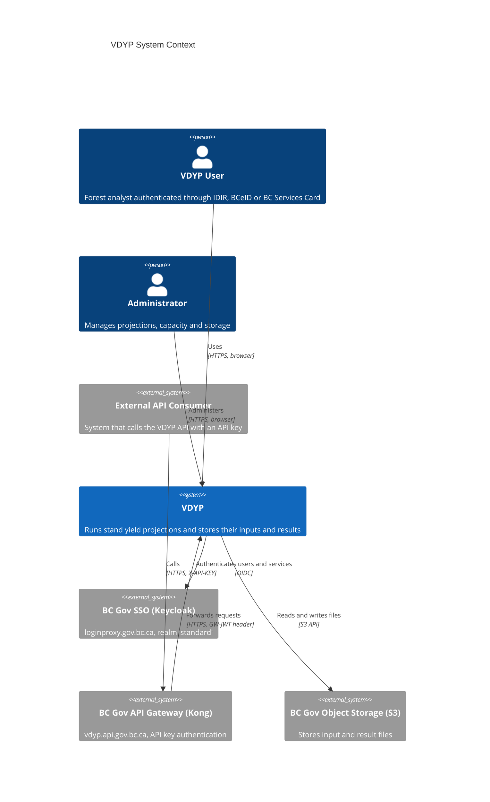
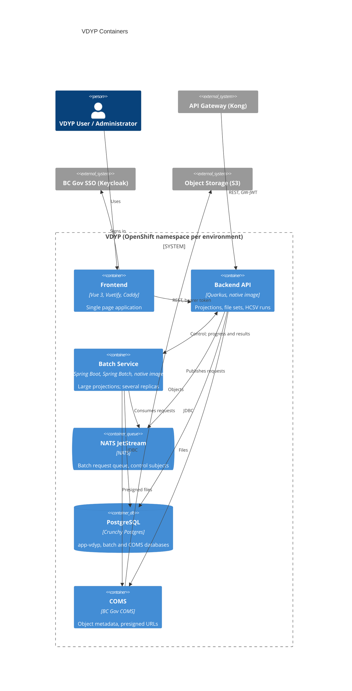
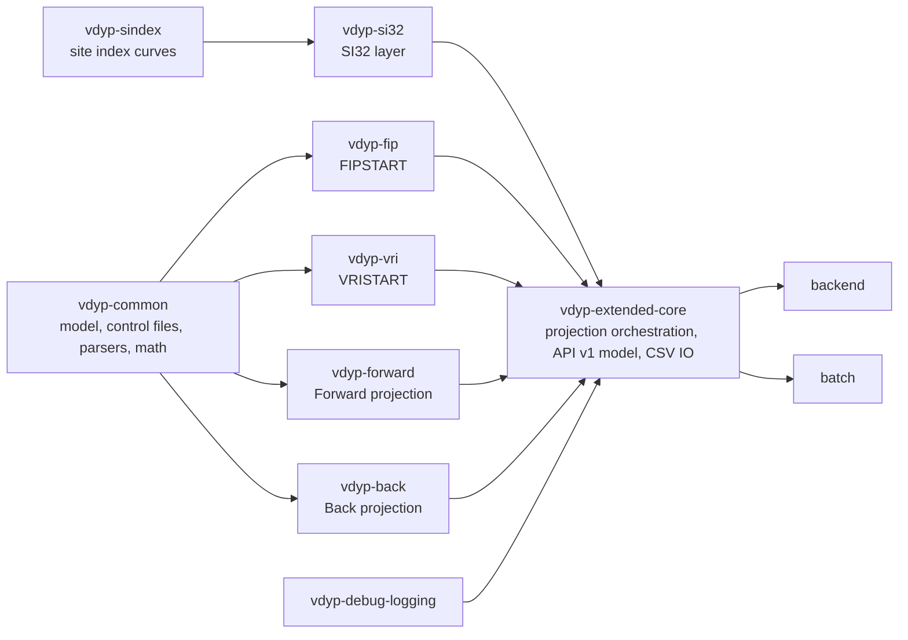
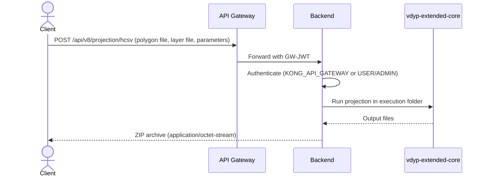
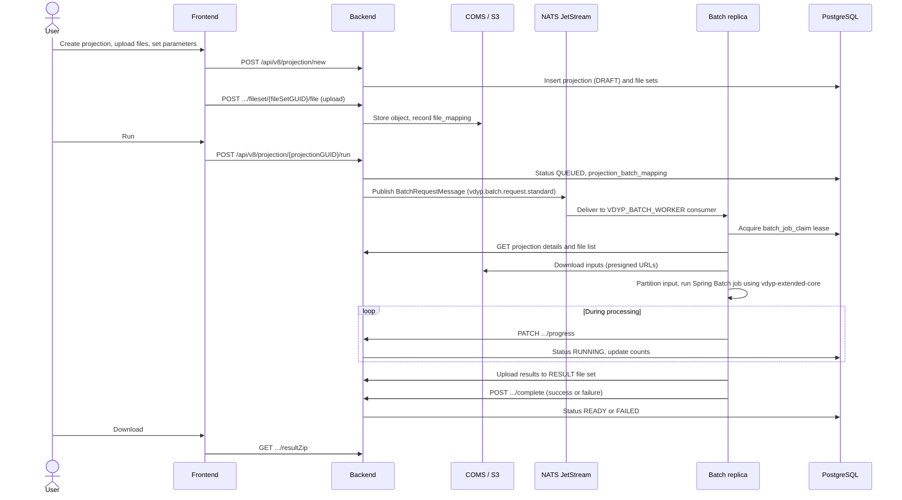
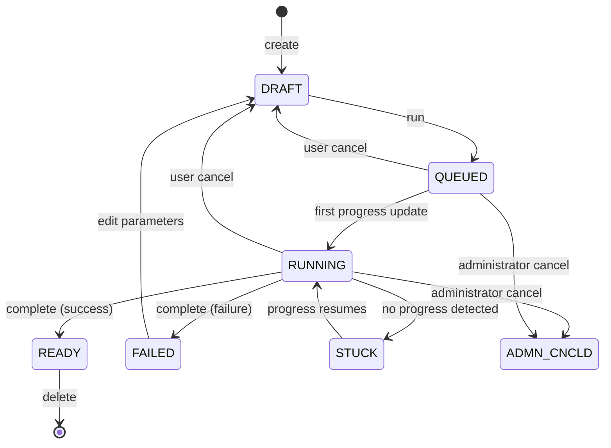
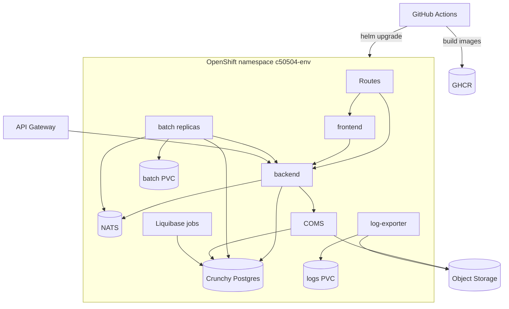

# VDYP Architecture Overview

This document describes the structure of the VDYP application as implemented in this repository. It was produced by scanning the source code, configuration, Helm charts and workflows. Where behaviour was inferred rather than read directly from code, the text says so.

Related documents:

- [Data model](data-model.md)
- [Glossary](../domain/glossary.md)
- [Conventions](../conventions/)
- [Deployment runbook](../deployment-runbook.md)

## 1. Purpose

VDYP (Variable Density Yield Projection) produces yield predictions for unmanaged British Columbia forest stands for inventory and timber supply applications. Version 8 (this repository) is a Java port of the VDYP7 computation engine, wrapped in a web application that lets users upload stand inventory files, configure projections, run them at scale, and download the results.

## 2. System context

## 3. Containers

Supporting containers not shown above: Liquibase jobs (apply schema changes to PostgreSQL), the Log Exporter (exports access logs from a PVC to object storage), and direct S3 access from the backend for file reads and writes.

| Container | Source | Technology | Notes |
| --- | --- | --- | --- |
| Frontend | `frontend/` | Vue 3, Vuetify 3, Pinia, Vite, Caddy | Runtime configuration injected as `window.config` by Caddy. |
| Backend API | `backend/` | Quarkus, Hibernate ORM with Panache, OIDC | Public API under `/api/v8`. Runs small projections in process. |
| Batch Service | `batch/` | Spring Boot, Spring Batch, jnats | Port 8081, context path `/vdyp-batch`, API under `/api/batch`. |
| Computation library | `lib/` | Plain Java 17 | Embedded in both backend and batch through `vdyp-extended-core`. |
| NATS JetStream | `nats/`, `charts/nats` | NATS 2.x | Stream `VDYP_BATCH_REQUESTS`, durable consumer `VDYP_BATCH_WORKER`. |
| PostgreSQL | `charts/crunchy-postgres`, `db/` | PostgreSQL 17 locally, Crunchy in OpenShift | Schemas managed by Liquibase. |
| COMS | `charts/app/templates/coms` | BC Gov COMS image | Deployed alongside the application. |
| Log Exporter | `log-exporter/` | Shell script, container | See `log-exporter/README.md`. |

## 4. Computation library

The arrows show the main dependency direction. Exact Maven dependencies are defined in each module `pom.xml`.

A projection runs in stages (`ProjectionStageCode`):

1. **Initial**: FIPSTART or VRISTART converts inventory input into VDYP polygons.
2. **Adjust**: adjustment of the initial values (defined in the enum; see the code for current use).
3. **Forward** or **Back**: grows the stand forwards or backwards in time.

`vdyp-extended-core` (`ProjectionRunner`, `PolygonProjectionRunner`, `ComponentRunner`) reads HCSV input, runs the stages for each polygon in an execution folder, and writes the requested outputs (yield tables, text reports, logs).

## 5. Key flows

### 5.1 Interactive HCSV projection

Used by external API consumers and for small runs. The request is processed synchronously in the backend and nothing is persisted.

### 5.2 Persistent batch projection

Used by the web application for projections that are saved, run asynchronously and downloaded later.

### 5.3 Control operations

- **Stop or cancel**: the backend calls the batch service, and stop requests are broadcast on `vdyp.batch.stop.request` so that the replica that owns the job can act. A user cancel returns the projection to `DRAFT`; an administrator cancel sets `ADMN_CNCLD`.
- **Prioritize**: administrators can prioritize a job; the request is broadcast on `vdyp.batch.prioritize.request`.
- **Stuck detection**: the backend `ProjectionStuckDetectionJob` marks `RUNNING` projections without recent progress as `STUCK`, and returns them to `RUNNING` when progress resumes.
- **Recovery**: each batch replica registers in `batch_worker_registry` and holds a lease in `batch_job_claim` for each job. If a replica stops sending heartbeats, another replica can recover the job after the lease expires.
- **Cleanup**: `ProjectionCleanupJob` removes expired projections. Administrators can run storage cleanup (batch PVC folders) and orphan file set cleanup (S3 objects without database references, see `backend/ORPHAN-FILE-CLEANUP.md`).

## 6. Projection lifecycle

Transitions are taken from `ProjectionService` and `ProjectionBatchMappingService` in the backend. The permitted actions for each status are defined in `ProjectionService.checkUserCanPerformAction`; consult it before relying on this diagram for edge cases.

## 7. Deployment

- Environments are `dev`, `test` and `prod`, each with its own `values-<env>.yaml` in `charts/app`.
- Helm charts: `app` (frontend, backend, batch, COMS, network policies, secrets), `nats`, `crunchy-postgres`, `liquibase`, and `api-gateway` (Kong configuration).
- Network policies (`charts/app/templates/knp.yaml`) allow router ingress to the frontend, backend, COMS and batch, allow frontend to backend and backend to batch traffic in both directions, and restrict database access to named components.
- Images are built and promoted as described in [the deployment runbook](../deployment-runbook.md). Liquibase changes are deployed separately with `.github/workflows/liquibase-ddl.yml`.
- Local development uses `docker-compose.yml`, which runs PostgreSQL, the three Liquibase migrations, MinIO, COMS, NATS, the backend, the batch service and the frontend.

## 8. Cross-cutting concerns

| Concern | Approach |
| --- | --- |
| Authentication | Keycloak OIDC for users (frontend and backend); API gateway JWT (`GW-JWT`) for external consumers; OAuth2 client credentials for batch to backend calls. See [security conventions](../conventions/security.md). |
| Authorization | Role based with `@RolesAllowed`: `USER`, `ADMIN`, `SYSTEM`, `KONG_API_GATEWAY`. |
| Configuration | Quarkus profiles (`%dev`, `%test`, `%prod`) and Spring properties, both with environment variable overrides. Frontend runtime configuration through `window.config`. |
| Persistence | PostgreSQL. Schemas owned by Liquibase; Hibernate validates the schema at startup. |
| Messaging | NATS JetStream work queue for batch requests; core NATS subjects for stop and prioritize broadcasts. |
| File storage | COMS and S3 for inputs and results; PVC for batch working folders. |
| Observability | Logback logging; Quarkus health at `/q/health`; Spring Actuator with Prometheus metrics in batch; access logs exported by `log-exporter`. |
| Native images | Backend and batch are built as GraalVM native images. Reflection registration (`@RegisterForReflection`, `VdypBackendReflectionConfiguration`) is required for classes serialized by Jackson. |
| Quality gates | `mvn -Pcoverage package verify formatter:validate` and SonarCloud on every pull request; frontend lint, type check and Cypress tests; OWASP ZAP scan workflow. |

## 9. Observations and open items

These points were noted during the scan and may be worth recording as ADRs or backlog items.

- The batch service permits all incoming HTTP requests (`IncomingSecurityConfiguration`) and relies on network isolation. However, `batch.route.enabled` is `true` in the dev, test and prod Helm values, so the batch API may be exposed through an OpenShift Route. See [security conventions](../conventions/security.md#3-network). This should be confirmed and resolved, then recorded as an ADR.
- `batch/src/main/resources/application.properties` contains a default value for `KEYCLOAK_CLIENT_SECRET`. Defaults for secrets should be removed and the value rotated if it is a real credential.
- `backend/src/main/resources/db/migration/V1.0.0__init.sql` defines a `java_api` schema outside the Liquibase process and appears to be legacy.
- The `projection_status_code` table comment lists values (Started, Completed, Canceled) that no longer match the codes in use.
- `backend/README.md` describes the original Jetty server stub, not the current Quarkus service.
- The `/dcsv` and `/scsv` endpoints are defined but return `501 Not Implemented`.

## 10. Candidate ADRs

The repository has no ADRs yet. The following decisions are already embodied in the code and are good candidates to record first:

1. Port VDYP7 to Java with exact numerical fidelity.
2. Quarkus for the API and Spring Boot for the batch service.
3. NATS JetStream as the batch work queue.
4. Lease based job ownership for batch replicas.
5. COMS and S3 for file storage.
6. Liquibase as the only schema management mechanism.
7. GraalVM native images for backend and batch.
8. Network isolation instead of authentication for the batch API.
