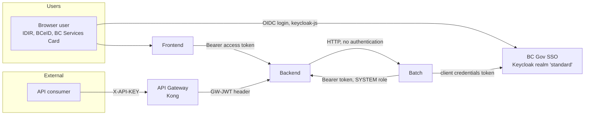

# Security Conventions

This document describes how VDYP authenticates and authorizes requests, how secrets and data are handled, and the rules for changes. Items marked **Open item** were observed during the scan and should be reviewed.

## 1. Identities and authentication

| Caller | Mechanism | Where |
| --- | --- | --- |
| Browser users | Keycloak OIDC through BC Gov SSO. The frontend obtains tokens with `keycloak-js`; the backend validates bearer tokens with `quarkus-oidc` (`application-type=SERVICE`). | `frontend/src/services/keycloak.ts`, `backend/.../application.properties` (`quarkus.oidc.*`) |
| External API consumers | Kong `key-auth` with the `X-API-KEY` header; Kong forwards a signed JWT in `GW-JWT`. The backend verifies it against the gateway JWKS, issuer and audience. | `charts/api-gateway/gw.yaml`, `ApiGatewayAuthenticationMechanism`, `ApiGatewayJwtVerifier` |
| Batch service calling the backend | OAuth2 client credentials (`spring.security.oauth2.client.registration.vdyp-client`). | `batch/.../application.properties`, `VdypRestClientConfig` |
| Backend calling the batch service | No authentication; relies on network policy. | `IncomingSecurityConfiguration` |

The frontend uses the backend `/auth/...` proxy (`AuthorizationProxyEndpoint`) to reach Keycloak endpoints.

## 2. Authorization

### 2.1 Roles

| Role | Source | Meaning |
| --- | --- | --- |
| `USER` | Added by `UserRolesAugmentor` when the token `identity_provider` claim is a user provider (IDIR, BCeID, BCSC). | Standard user. |
| `ADMIN` | Keycloak client role (`client_roles` claim). | Administrator: all projections, capacity, storage, prioritization, cleanup. |
| `SYSTEM` | Keycloak client role on the service account. | Batch service callbacks (progress, completion, result upload). |
| `KONG_API_GATEWAY` | Added by `ApiGatewayAuthenticationMechanism` for verified gateway requests. | External API consumers; limited to `/hcsv`. |

The `user_type_code` table also defines `SUPERUSER`. It is not used by `@RolesAllowed` in the current code.

### 2.2 Rules

- The global policy authenticates every path (`quarkus.http.auth.permission.authenticated.paths=/*`). Exceptions are listed in `quarkus.http.auth.permission.permitted.paths`: `/auth/*`, `/api/v8/projection/scsv`, `/api/v8/help`, `/q/health`. Adding a path to that list needs explicit review.
- Every endpoint declares `@RolesAllowed` with the narrowest set of roles.
- Role checks are not sufficient for projection data. Every operation on a projection or file set must also pass the ownership and status check in `ProjectionService.checkUserCanPerformAction`. Administrators may act on other users' projections only where that method allows it.
- `OidcUserSyncFilter` creates or updates the `vdyp_user` row for each authenticated user. Do not trust names or emails from the request body; use the token.

## 3. Network

- OpenShift network policies (`charts/app/templates/knp.yaml`) allow ingress from the OpenShift router to the frontend, backend, COMS and batch; allow frontend to backend, backend to batch and batch to backend; and restrict access to the application database to the backend and COMS.
- **Open item (high priority):** the batch API permits all requests (`authorizeHttpRequests(a -> a.anyRequest().permitAll())`) and disables CSRF for its endpoints. The batch Helm template creates an OpenShift Route when `batch.route.enabled` is true, and that value is `true` in `values-dev.yaml`, `values-test.yaml` and `values-prod.yaml`, although the comment in the values files says "dev only for debugging". Together with the router ingress policy, this suggests the unauthenticated batch API (including stop, prioritize and storage cleanup) may be reachable from outside the cluster in every environment. Confirm the deployed state, then either disable the route outside dev or add authentication to the batch API.
- CORS on the backend is restricted to `CORS_FRONTEND_BASE_URL`, methods `GET, POST, PUT, DELETE, OPTIONS`, headers `Content-Type, Authorization`. Note that `PATCH` is not listed; it is only used by the batch service, which does not need CORS.

## 4. Secrets and configuration

- Secrets are supplied as environment variables from OpenShift secrets (`charts/app/templates/secret.yaml`) or GitHub environment secrets. They must never be committed.
- Configuration placeholders must not contain real secret values as defaults. Use an empty default or fail at startup.
- **Open item:** `batch/src/main/resources/application.properties` contains a non-empty default for `KEYCLOAK_CLIENT_SECRET`, and defaults such as `password` for COMS and database credentials. If the client secret default is a real credential, rotate it and remove the default.
- Local development values belong in `.env` files or Docker Compose overrides that are ignored by Git.

## 5. Data protection

- Projection inputs and results are stored in object storage through COMS. Access is mediated by the backend; the browser receives files only through authorized endpoints. The batch service uses short-lived presigned URLs (`coms.object.presign-expires-in`, default 300 seconds).
- Personal information stored is limited to the user profile in `vdyp_user` (names, display name, email, OIDC identifier, identity provider).
- Do not log tokens, API keys, presigned URLs, or file contents. User debug logs requested through projection parameters are written to the projection output, not to application logs.
- Destructive administrative operations default to safe modes (for example orphan file cleanup with `dryRun=true`) and record their outcome (`storage_cleanup_run`).
- Backend access logs are retained and exported by `log-exporter`; retention and review responsibilities are described in `log-exporter/README.md`.

## 6. Dependency and code security

- CI runs SonarCloud analysis on every pull request (`.github/workflows/maven.yml`) and an OWASP ZAP full scan workflow (`zap-full-scan.yml`).
- Keep dependency versions current through the root `dependencyManagement`, the Quarkus and Spring Boot BOMs, and `frontend/package-lock.json`. Pin container base images by digest where practical (the batch Dockerfile already pins the GraalVM image).
- Validate all uploaded files at the boundary (size limits, CSV structure, polygon counts). Size limits are configured in `CsvUploadConfig`, `ProjectionLimitsConfig` and `spring.servlet.multipart.*`.

## 7. Review checklist

For any change that touches authentication, authorization, storage, or external integrations:

1. Each new endpoint has `@RolesAllowed` and an ownership check where it handles user data.
2. No new path is added to the permitted (public) list without justification.
3. No secret, token or credential appears in code, configuration defaults, tests or logs.
4. New configuration for credentials is read from environment variables.
5. Inputs are validated and size limited.
6. Network policies and Helm values are updated if a component needs a new connection.
