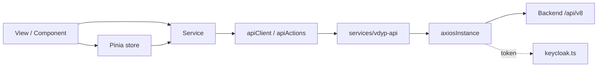

# Frontend Conventions (Vue)

The VDYP frontend in `frontend/` is a Vue 3 single page application. These conventions describe the current code.

## 1. Stack

| Concern | Choice |
| --- | --- |
| Framework | Vue 3, Composition API with `<script setup lang="ts">` |
| Language | TypeScript (`vue-tsc` for type checking) |
| Build | Vite |
| UI components | Vuetify 3, Material Design Icons (`@mdi/font`) |
| Design system | `@bcgov/design-tokens`, `@bcgov/bc-sans` |
| State | Pinia |
| Routing | Vue Router 4 |
| HTTP | Axios, through a shared `axiosInstance` |
| Authentication | `keycloak-js` |
| Tests | Cypress (component and end-to-end) |
| Serving | Caddy in a container |
| Node | 22 (CI) |

## 2. Project structure

| Folder | Contents | Rule |
| --- | --- | --- |
| `views/` | Route level pages | One view per route. Views compose components and stores. |
| `components/core/` | Generic `App*` building blocks (`AppSnackbar`, `AppTabs`, ...) | Reuse before creating new base components. |
| `components/common/`, `components/layout/` | Shared and layout components | |
| `components/projection/` | Feature components (`input`, `list`, `reporting`) | Group by feature. |
| `stores/` | Pinia stores (`common/`, `projection/`) | State and state transitions only. |
| `services/` | API access and domain services | The only place that calls the backend. |
| `services/vdyp-api/` | OpenAPI Generator style client (`apis/`, `models/`) | Must match the backend API. |
| `validation/` | `*Validation.ts` rules and `*Validator.ts` classes per form section | |
| `composables/` | Reusable composition functions (`use*`) | |
| `constants/` | Business constants, defaults, options, messages, CSV headers | No magic numbers or inline user-facing strings in components. |
| `utils/`, `interfaces/`, `types/` | Helpers and shared types | |
| `styles/` | SCSS overrides for Vuetify components | |

Imports use the `@/` alias for `src/`.

## 3. Code style

- Prettier (`.prettierrc.yml`): two space indentation, single quotes, no semicolons, trailing commas, LF line endings, `proseWrap: always`.
- ESLint (`eslint.config.js`). CI runs `npm run lint:check`; use `npm run lint` locally to fix.
- Component files use PascalCase names (`ProjectionListView.vue`, `AppTabs.vue`). TypeScript modules use camelCase (`projectionService.ts`, `fileUploadStore.ts`).
- Stores are named `<name>Store.ts` and composables `use<Name>.ts`.
- Type props and emits with `defineProps<...>()` and `defineEmits<...>()`.

## 4. Data flow

- Components do not call Axios or the generated API classes directly.
- `axiosInstance` attaches the Keycloak bearer token and handles refresh. `apiErrorHandler` converts API errors into user messages.
- User messages are shown through the notification and alert dialog stores in `stores/common`.

## 5. Configuration

- Read configuration from `env` in `src/env.ts`, which merges `import.meta.env` with `window.config`.
- In deployed environments, Caddy writes `window.config` from environment variables (`VITE_SSO_AUTH_SERVER_URL`, `VITE_SSO_CLIENT_ID`, `VITE_SSO_REALM`, `VITE_SSO_REDIRECT_URI`, `VITE_API_URL`, `VITE_SSO_TOKEN_ISSUER`, `BACKEND_URL`, `OBJECTSTORE_URL`, feature flags). A new variable must be added to the `Caddyfile` and to the Helm values.

## 6. Validation and business rules

- Input limits, defaults and option lists live in `constants/`. Validation logic lives in `validation/`.
- Rules must stay consistent with backend validation in `vdyp-extended-core` (`ProjectionRequestParametersValidator`). When a rule changes on one side, change the other.

## 7. Accessibility and design

- Use Vuetify components styled with BC Gov design tokens. Follow the BC Gov design system for colour, typography and layout.
- Provide labels for all inputs and keep keyboard navigation working for custom components.

## 8. Testing

See [testing conventions](testing.md#frontend). Every service, store, validator, utility and component change needs a matching `*.cy.ts` spec next to the source file.
